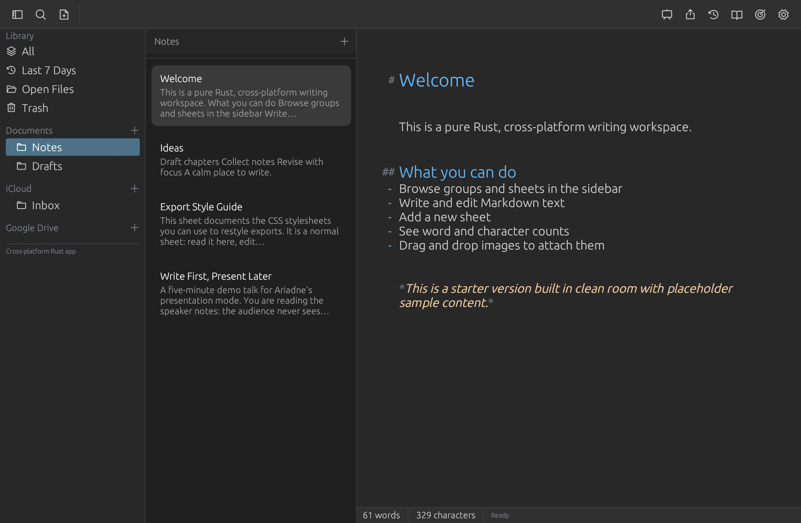
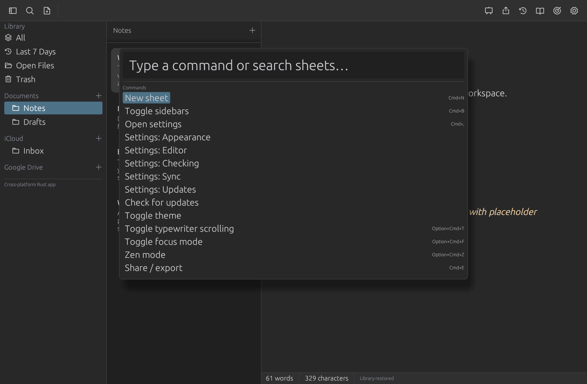
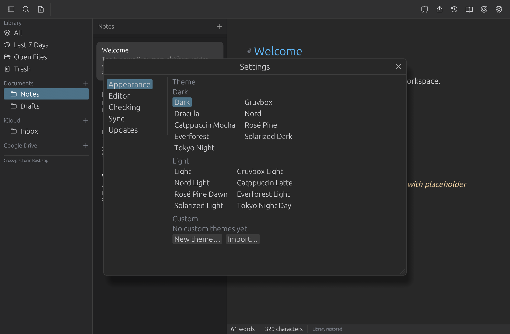
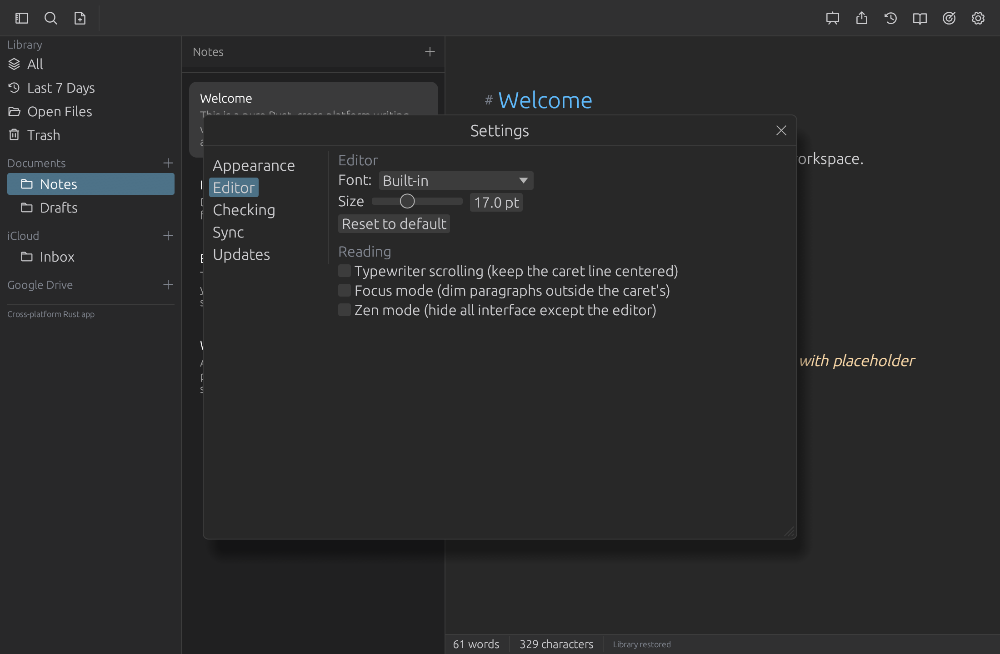
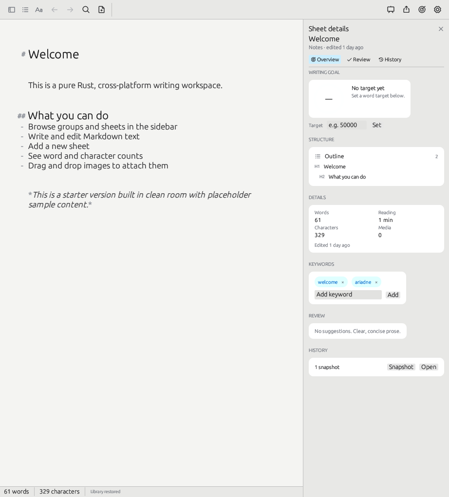
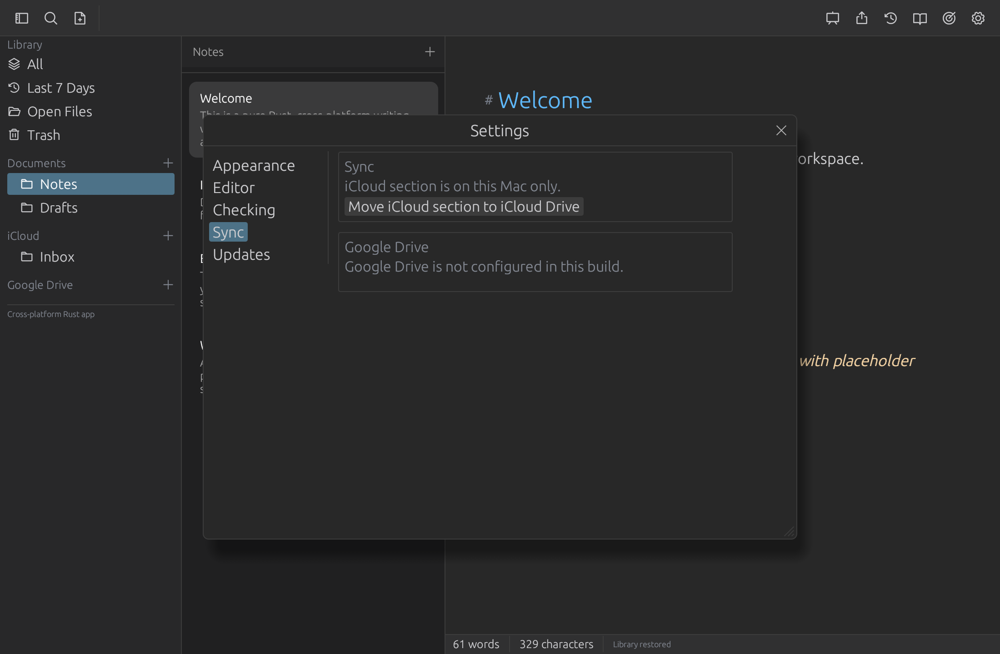
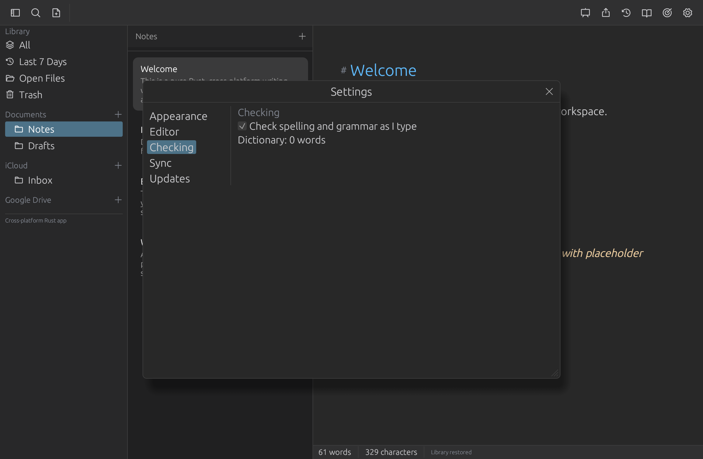
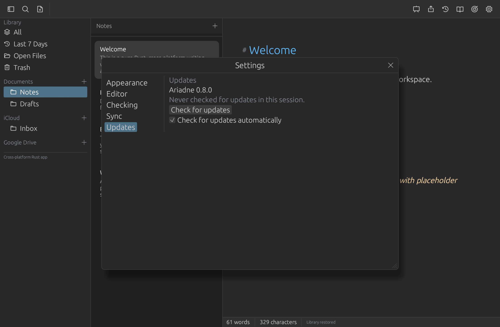

# Ariadne

A pure-Rust, cross-platform desktop writing workspace — library and sheets
sidebar, Markdown editing with live word/character counts, and styled export
to Markdown, HTML, PDF, Word (.docx), Rich Text (.rtf), and ePub.

Built with [egui](https://github.com/emilk/egui) (`eframe`). No web views,
no runtime beyond the OS GUI layer.



## Library, sheets, and editor

- **Library sidebar:** `All`, `Last 7 Days`, `Favorites`, `Open Files`, and
  `Trash` smart filters, plus `Documents`, `iCloud`, and `Google Drive`
  sections containing groups of sheets. Back/forward buttons and
  `Cmd/Ctrl+[` / `]` return to recently visited sheets.
- **Sheets list:** per-group sheet cards with title, preview, word/reading
  count, edited age, keywords in search, multi-select, and a sheets header
  `+` for new sheets. Right-click a sheet to mark it as **material**:
  material sheets are grouped under `MATERIAL` at the bottom, stay editable
  and searchable, and are excluded from export, statistics, goals, and
  presentation.
- **Editor:** Markdown source editing with muted syntax markers, `#` margin
  marks, lists (`Return` continues, `Tab`/`Shift-Tab` nests), checklists,
  quotes, code, and drag-and-drop image attachments (``).
  Dropping Markdown, plain-text, or project-archive (`.zip`) files imports
  them instead; image files are attached.
  Selecting text opens a floating markup bar for bold, italic, heading, link,
  quote, and code. `Ctrl/Cmd+click` a link to open it; internal links
  (`#heading-slug`, or `ariadne://<sheet-id>#heading-slug` copied from the
  outline) jump within the project, and incoming links appear in Overview.
- **Split editor:** `Cmd/Ctrl+Alt+S` or the column icon opens a second editor.
  Choose its sheet from the pane header, place the panes side by side or
  stacked, and scroll each one independently. The accent border marks
  the editor with keyboard focus.
- **Tables and equations:** Markdown pipe tables render in the preview and
  exports (native HTML/ePub and Word tables; aligned text in PDF and RTF).
  `Table editor…` in the command palette (or the table icon in the selection
  bar) opens a grid for adding/removing rows and columns and setting
  per-column alignment; `Insert equation` adds display math. Inline math (`$...$`) and display math (`$$...$$`) accept
  common LaTeX (Greek, fractions, roots, sums, operators, sub/superscripts)
  and export as readable Unicode.
- **Toolbar:** a three-segment pane switcher, back/forward history, and a
  single Sheet details button; export, present, and settings stay on the
  right.
- **Keyboard-first navigation:** arrow keys move through the library, the
  sheets list, and the editor; `Return` drills in and `Cmd/Ctrl+Return`
  goes back up. Focus mode can keep the paragraph, line, or sentence under
  the caret bright.
- **Status bar:** live word and character counts plus a status line.

## Command palette and shortcuts

Press `Cmd/Ctrl+Shift+P` (magnifying-glass icon) to fuzzy-search sheets and
run commands:



| Shortcut | Action |
| --- | --- |
| `Cmd/Ctrl+N` | New sheet |
| `Cmd/Ctrl+B` | Toggle sidebars |
| `Cmd/Ctrl+[` / `]` | Back / forward through sheet history |
| `Cmd/Ctrl+1` | Show library, sheets, and editor |
| `Cmd/Ctrl+2` | Sheets and editor (hide library) |
| `Cmd/Ctrl+3` | Editor only |
| `Cmd/Ctrl+Shift+P` | Command palette / search |
| `Cmd/Ctrl+F` | Find in sheet |
| `Cmd/Ctrl+E` | Share / export |
| `Cmd/Ctrl+P` | Present |
| `Cmd/Ctrl+G` | Sheet details (overview) |
| `Cmd/Ctrl+/` | Review tab |
| `Cmd/Ctrl+Y` | History tab |
| `Cmd/Ctrl+,` | Settings |
| `Cmd/Ctrl+Alt+T` / `F` / `Z` | Typewriter / Focus / Zen mode |
| `Cmd/Ctrl+Alt+R` | Revision mode |
| `Cmd/Ctrl+Alt+S` | Split editor |
| `Esc` | Leave Zen or revision mode, close find/palette |

## Appearance and editor settings

Settings (`Cmd/Ctrl+,`, gear icon) has five tabs: Appearance, Editor,
Checking, Sync, and Updates.



- **Appearance:** 9 dark and 8 light built-in themes (Dark, Light, Gruvbox,
  Dracula, Nord, Catppuccin, Rosé Pine, Everforest, Solarized, Tokyo Night,
  and their light variants), plus custom themes (`New theme…`, `Import…`,
  Edit/Save/Copy/Delete). An **Interface scale** slider and presets
  (75%–200%) — also driven by Ctrl +/- — scale the whole app for the current
  display and are saved the moment they change, along with the window
  geometry; editor text size stays a separate setting. A **Scroll speed**
  slider (0.25×–4×) tunes wheel/trackpad scrolling for the machine.
- **Editor:** system font family picker, 8–32 pt size slider, and reading
  modes:



  - Typewriter scrolling (caret line centered),
  - Focus mode (dims text outside the caret's; keep the paragraph, line, or
    sentence bright),
  - Zen mode (editor only; `Esc` leaves),
  - Revision mode (`Cmd/Ctrl+Alt+R`): dims the text, hides the library pane,
    and opens the Review tab for a focused pass over style suggestions.

## Sheet details dashboard

The header bar's target icon opens the right-hand dashboard; its tabs switch
between Overview, Review (`Cmd/Ctrl+/`), and History (`Cmd/Ctrl+Y`):



- **Overview:** writing goal with a progress ring, daily word target, optional
  deadline with required words/day, a 14-day writing-history chart, outline,
  sheet details (words, characters, reading time, media, created and edited
  dates), image thumbnails, editable keywords, incoming links (backlinks),
  review summary, and history summary.
- **Review:** concision and clarity notes with click-to-jump and one-click
  fixes; its open/closed state is remembered across runs.
- **History:** per-sheet snapshots with age/character counts, `Snapshot now`,
  `Clear`, and per-snapshot `Restore`.

Create a starter project from **New from template…** in the command palette or
the library footer: Novel, Blog, Notes, Research, or a blank project. Each
template lands as one new top-level group with its starter groups nested
inside. Groups can be given an icon, a color, and their own sheet ordering
(manual, title, last edited, or date created) from the group context menu; a
group's color also becomes its highlight color when selected, with
contrasting text. The keyword manager (command palette, or **Manage…** in
Overview) renames, merges, deletes, colors, and favorites keywords
library-wide.

On narrow windows and tiling-WM tiles, opening the dashboard gives it the
library/sheet-list space so the editor keeps a readable measure; closing it
restores the sidebars.

## Present mode

`Cmd/Ctrl+P` (presentation icon) turns the current sheet into a slide deck:
each heading starts a new slide, visual blocks (bullets, quotes, code,
images) render on the slide, and plain paragraphs become presenter-only
speaker notes. `---` makes an untitled image slide. Arrows move, `Esc` ends.


The setup view offers `Style` (color theme from Coolors palettes, header/body
fonts, background colors, aspect ratio) and `Slides` (filmstrip) tabs, a `Play`
button, teleprompter notes, a timer, and deck export. `example-slideshow.md`
is a five-minute demo talk written for this mode. Tick `Handout` in Export to
emit slides plus script.

## Export

Export to Markdown, HTML, PDF, Word, Rich Text, and ePub with built-in
styles (Built-in, Manuscript, Student, Paperback Novel, Professional) or your
own CSS:


- Pick a style from the left list, then a format from the right grid.
- `Create New Style` starts from a starter template; the icon row edits the
  active style (built-ins open as a copy), imports a `.css` file, deletes the
  style, or attaches a font file (`.ttf`/`.otf`/`.ttc`) for export-only fonts.
- `Preview`, `Save to file`, and `Open with default app` are the outputs.
- Write `(toc)` on its own line to expand a table of contents from the
  sheet's headings (linked in Markdown and HTML/ePub).
- **Share project archive** exports the whole library — sheets, groups,
  attachments, history, and settings — as one `.zip` for backup or moving to
  another machine. **Import project archive…** (in the same panel or the
  command palette, or by dropping the `.zip`) merges one back in; imports
  never delete sheets that are newer than the archive.
- The `Export Style Guide` starter sheet documents the stylesheet selectors;
  the `Write First, Present Later` starter sheet documents present mode.

## iCloud sync (Mac)

Groups in the **iCloud** section sync through iCloud Drive — no account or
sign-in needed beyond having iCloud Drive enabled. The section is mirrored
as a plain tree of folders and `.md` files, so it stays readable in Finder
and Spotlight; the app's JSON store remains the source of truth and rewrites
the mirror on every save. Documents stay local on each Mac.



- Move the store under Settings → Sync (“Move iCloud section to iCloud
  Drive”, or back). Moving unions both sides, never overwrites.
- Editing the same sheet on two Macs keeps the newer version and preserves
  the other as a `(conflict copy)` sheet for review (header badge → popup:
  keep current, keep copy, or keep both).
- Deletions sync via tombstones and stay deleted; trash still works as
  before, per machine.

## Google Drive sync (all platforms)

Groups in the **Google Drive** section sync through a user-visible
`Ariadne` folder in your My Drive — same model as iCloud: one JSON store
file plus a plain tree of folders and `.md` files, mirrored on every save.
Connect under Settings → Sync (“Connect Google Drive”); auth happens once
in the browser (OAuth, PKCE loopback flow) and tokens stay in the OS
keychain. Syncs on save (debounced) and checks for remote changes every 30
seconds; conflicts get the same `(conflict copy)` review as iCloud.

## Spelling, grammar, and style (offline)

Checking runs fully on-device with [Harper](https://github.com/automerge/harper)
— no account, no network, your text never leaves the Mac:



- **Inline:** spelling and grammar mistakes get red/blue squiggles as you
  type. Put the caret in one for a fix popup (apply, ignore, or add the
  word to your dictionary).
- **Review tab** (in the sheet dashboard): concision and clarity notes —
  wordy phrases, passive voice, redundancies — with click-to-jump and
  one-click fixes. Its open/closed state is remembered across runs.
- **Custom dictionary:** words you add sync across devices with the rest of
  the library (removing one syncs the removal too); manage the list in
  Settings, which is also where the master toggle lives.

## Updates



The app checks those GitHub Releases for updates: once a day after launch
(plus a manual "Check for updates" in Settings → Updates and the command
palette). When a newer version is out, Settings shows an Updates tab with
release notes and a Download button that opens the right installer for your
OS — the app never replaces itself. A red dot on the Settings gear marks an
available update. Checks can be turned off in the same tab.

## Files and storage

- Local library: OS app-data folder (`com.craft-anything.ariadne`),
  `library.json` plus `window.json` (geometry), custom themes, and the
  `ariadne-styles` folder. The status bar shows **Saving…**, **Saved**, or a
  red **Not saved** with the reason and automatic retries.
- `ARIADNE_LIBRARY_PATH`, `ARIADNE_WINDOW_PATH`, `ARIADNE_ICLOUD_DIR`, and
  `ARIADNE_GDRIVE_DIR` redirect storage (used by tests and screenshot runs).
- Sync mirrors stay human-readable: folders plus `.md` files for iCloud
  Drive and Google Drive.

## Run from source

```sh
cd app
cargo run --release
```

Headless smoke check (saves a screenshot instead of opening a window):

```sh
cd app
./target/debug/ariadne --screenshot shots/check.png
```

Docs screenshot hooks (session-only, never persisted):

```sh
ARIADNE_SCREENSHOT_POPOVER=1 … --screenshot shots/export.png
ARIADNE_SCREENSHOT_PRESENT=1 … --screenshot shots/present.png
ARIADNE_SCREENSHOT_SETTINGS=Appearance|Editor|Checking|Sync|Updates …
ARIADNE_SCREENSHOT_SEARCH=1|STYLE=1|GOALS=1|HISTORY=1 …
```

Combine with `ARIADNE_LIBRARY_PATH` / `ARIADNE_WINDOW_PATH` /
`ARIADNE_ICLOUD_DIR` / `ARIADNE_GDRIVE_DIR` / `ARIADNE_NO_UPDATE_CHECK=1`
for isolated docs captures.

## Browser build (PWA)

The same app runs in the browser at `/app/` on the GitHub Pages site:
full editor, library, themes, history, export, and present mode. The
library persists in the browser's `localStorage` (no account, no server);
sync (iCloud / Google Drive), update checks, and OS integrations
(clipboard image paste, file dialogs, "open with") are desktop-only. A
browser save that cannot be read is preserved and offered as **Download
recovered library…** in the command palette instead of being overwritten.

```sh
cd app
cargo install trunk --locked   # or fetch a prebuilt trunk binary
trunk serve --no-default-features        # local dev, opens the app
```

Release bundle (what CI deploys):

```sh
cd app
trunk build --release --cargo-profile release-wasm --dist dist-web --public-url /ariadne/app/ --no-default-features
```

`release-wasm` matches `release` but keeps the `target_features` section
that `strip` would remove (wasm-opt needs it to validate).

Pushing to `main` builds and deploys the site (marketing pages from
`docs/` plus the app bundle) via the `Web` workflow. One-time repo setup:
Settings → Pages → Source → **GitHub Actions**.

## Tests

```sh
cd app
cargo test
```

## Releases

Tagged versions build signed-or-notarized-free artifacts for macOS, Windows,
and Linux via GitHub Actions. See [DISTRIBUTING.md](DISTRIBUTING.md).

## License

MIT — see [LICENSE-MIT](LICENSE-MIT). Third-party dependency licenses are
audited in CI (`deny.toml`); all dependencies are MIT/Apache-2.0/BSD/ISC
or similarly permissive.
