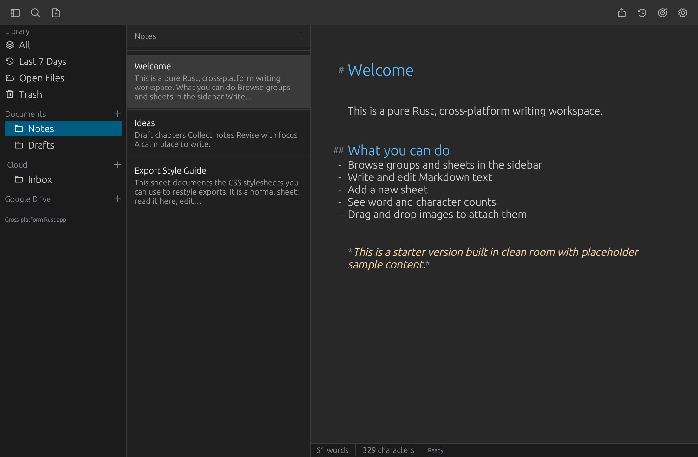
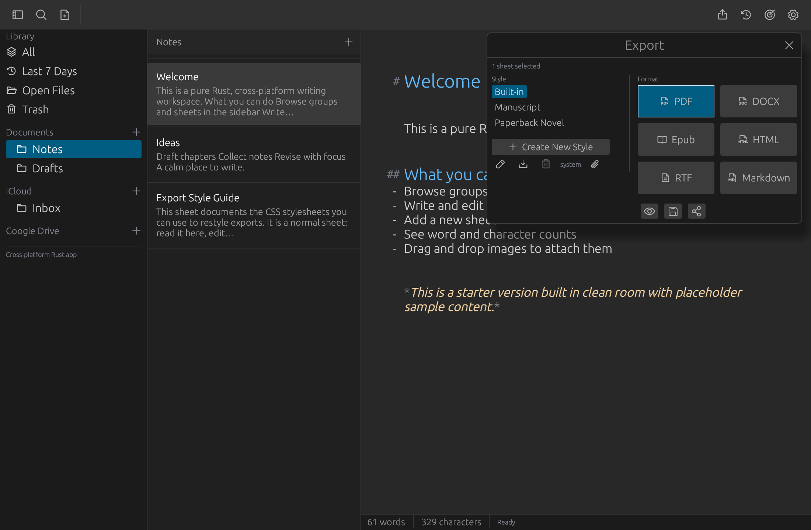

# Ariadne

A pure-Rust, cross-platform desktop writing workspace — library and sheets
sidebar, Markdown editing with live word/character counts, and styled export
to Markdown, HTML, PDF, Word (.docx), Rich Text (.rtf), and ePub.

Built with [egui](https://github.com/emilk/egui) (`eframe`). No web views,
no runtime beyond the OS GUI layer.



Export to Markdown, HTML, PDF, Word, Rich Text, and ePub with built-in
styles (Manuscript, Student, Paperback Novel, Professional) or your own CSS:



## iCloud sync (Mac)

Groups in the **iCloud** section sync through iCloud Drive — no account or
sign-in needed beyond having iCloud Drive enabled. The section is mirrored
as a plain tree of folders and `.md` files, so it stays readable in Finder
and Spotlight; the app's JSON store remains the source of truth and rewrites
the mirror on every save. Documents stay local on each Mac.

- Move the store under Settings → Sync (“Move iCloud section to iCloud
  Drive”, or back). Moving unions both sides, never overwrites.
- Editing the same sheet on two Macs keeps the newer version and preserves
  the other as a `(conflict copy)` sheet for review (header badge → popup:
  keep current, keep copy, or keep both).
- Deletions sync via tombstones and stay deleted; trash still works as
  before, per machine.

## Spelling, grammar, and style (offline)

Checking runs fully on-device with [Harper](https://github.com/automerge/harper)
— no account, no network, your text never leaves the Mac:

- **Inline**: spelling and grammar mistakes get red/blue squiggles as you
  type. Put the caret in one for a fix popup (apply, ignore, or add the
  word to your dictionary).
- **Style sidebar** (book icon in the header): concision and clarity notes —
  wordy phrases, passive voice, redundancies — with click-to-jump and
  one-click fixes. Its open/closed state is remembered across runs.
- **Custom dictionary**: words you add sync across devices with the rest of
  the library (removing one syncs the removal too); manage the list in
  Settings, which is also where the master toggle lives.

## Run from source

```sh
cd app
cargo run --release
```

Headless smoke check (saves a screenshot instead of opening a window):

```sh
cd app
./target/debug/ariadne --screenshot shots/check.png
```

## Tests

```sh
cd app
cargo test
```

## Releases

Tagged versions build signed-or-notarized-free artifacts for macOS, Windows,
and Linux via GitHub Actions. See [DISTRIBUTING.md](DISTRIBUTING.md).

## License

MIT — see [LICENSE-MIT](LICENSE-MIT). Third-party dependency licenses are
audited in CI (`deny.toml`); all dependencies are MIT/Apache-2.0/BSD/ISC
or similarly permissive.
