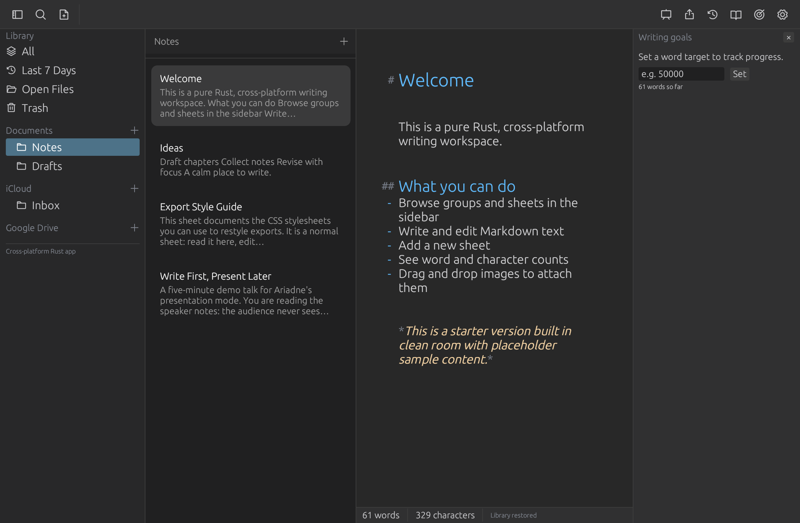
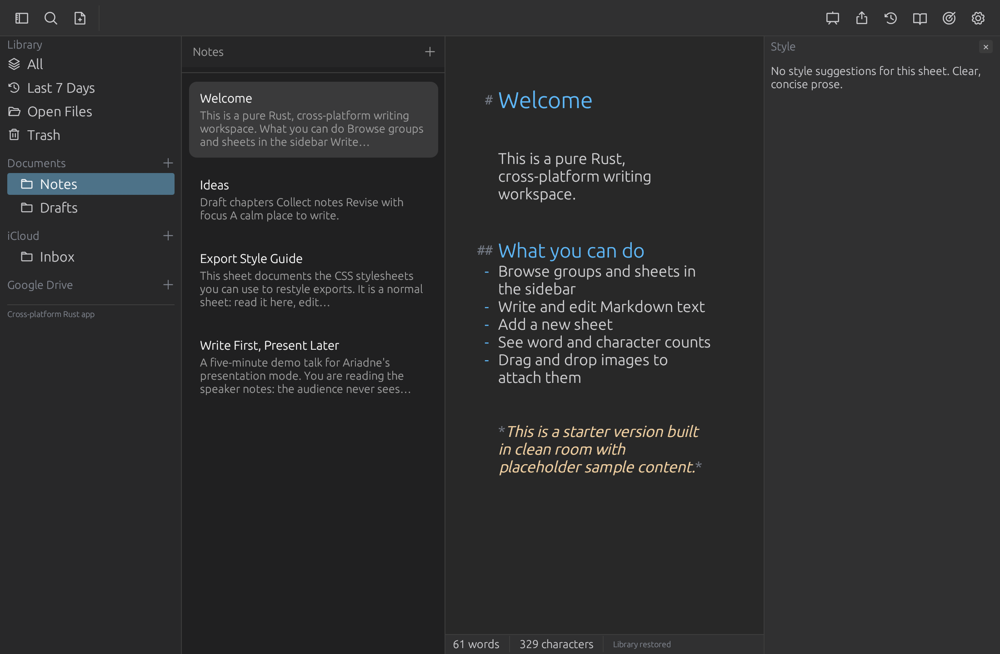
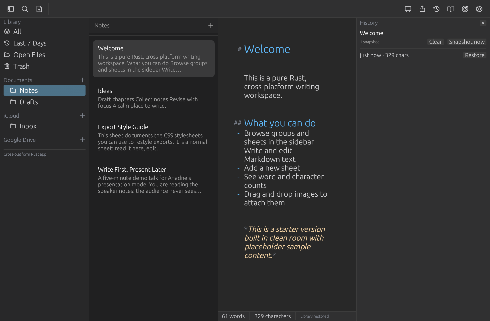
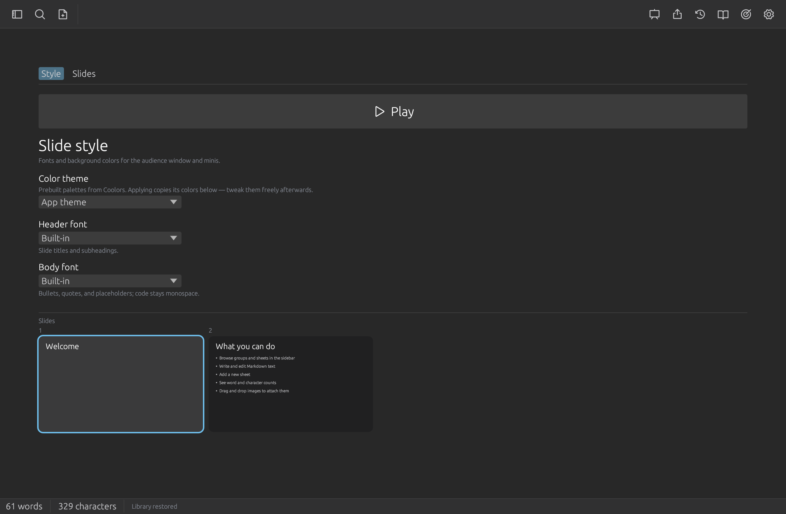
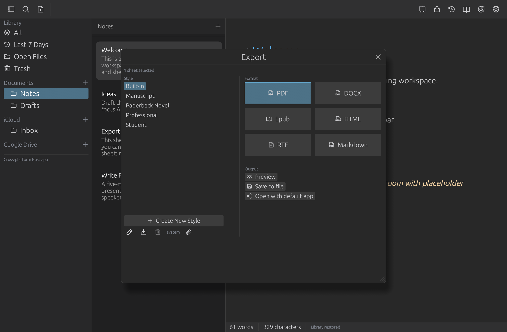

# Ariadne

A pure-Rust, cross-platform desktop writing workspace — library and sheets
sidebar, Markdown editing with live word/character counts, and styled export
to Markdown, HTML, PDF, Word (.docx), Rich Text (.rtf), and ePub.

Built with [egui](https://github.com/emilk/egui) (`eframe`). No web views,
no runtime beyond the OS GUI layer.


## Library, sheets, and editor

- **Library sidebar:** `All`, `Last 7 Days`, `Open Files`, and `Trash` smart
  filters, plus `Documents`, `iCloud`, and `Google Drive` sections containing
  groups of sheets.
- **Sheets list:** per-group sheet cards with title and preview text,
  multi-select, and a sheets header `+` for new sheets.
- **Editor:** Markdown source editing with syntax tinting, `#` margin marks,
  lists (`Return` continues, `Tab`/`Shift-Tab` nests), checklists, quotes, code,
  and drag-and-drop image attachments (``).
- **Status bar:** live word and character counts plus a status line.

## Command palette and shortcuts

Press `Cmd/Ctrl+Shift+P` (magnifying-glass icon) to fuzzy-search sheets and
run commands:


| Shortcut | Action |
| --- | --- |
| `Cmd/Ctrl+N` | New sheet |
| `Cmd/Ctrl+B` | Toggle sidebars |
| `Cmd/Ctrl+Shift+P` | Command palette / search |
| `Cmd/Ctrl+F` | Find in sheet |
| `Cmd/Ctrl+E` | Share / export |
| `Cmd/Ctrl+P` | Present |
| `Cmd/Ctrl+G` | Writing goals |
| `Cmd/Ctrl+/` | Style suggestions |
| `Cmd/Ctrl+Y` | History |
| `Cmd/Ctrl+,` | Settings |
| `Cmd/Ctrl+Alt+T` / `F` / `Z` | Typewriter / Focus / Zen mode |
| `Esc` | Leave Zen mode, close find/palette |

## Appearance and editor settings

Settings (`Cmd/Ctrl+,`, gear icon) has five tabs: Appearance, Editor,
Checking, Sync, and Updates.


- **Appearance:** 9 dark and 8 light built-in themes (Dark, Light, Gruvbox,
  Dracula, Nord, Catppuccin, Rosé Pine, Everforest, Solarized, Tokyo Night,
  and their light variants), plus custom themes (`New theme…`, `Import…`,
  Edit/Save/Copy/Delete).
- **Editor:** system font family picker, 8–32 pt size slider, and reading
  modes:


  - Typewriter scrolling (caret line centered),
  - Focus mode (dims paragraphs outside the caret's),
  - Zen mode (editor only; `Esc` leaves).

## Goals, history, and style sidebar

The header bar's target, clock, and book icons open three right sidebars:



- **Writing goals:** per-library word target with progress (`Set a word
  target to track progress`).
- **History:** per-sheet snapshots with age/character counts, `Snapshot now`,
  `Clear`, and per-snapshot `Restore`.
- **Style sidebar:** concision and clarity notes with click-to-jump and
  one-click fixes; its open/closed state is remembered across runs.




## Present mode

`Cmd/Ctrl+P` (presentation icon) turns the current sheet into a slide deck:
each heading starts a new slide, visual blocks (bullets, quotes, code,
images) render on the slide, and plain paragraphs become presenter-only
speaker notes. `---` makes an untitled image slide. Arrows move, `Esc` ends.



The setup view offers `Style` (color theme from Coolors palettes, header/body
fonts, background colors, aspect ratio) and `Slides` (filmstrip) tabs, a `Play`
button, teleprompter notes, a timer, and deck export. `example-slideshow.md`
is a five-minute demo talk written for this mode. Tick `Handout` in Export to
emit slides plus script.

## Export

Export to Markdown, HTML, PDF, Word, Rich Text, and ePub with built-in
styles (Built-in, Manuscript, Student, Paperback Novel, Professional) or your
own CSS:



- Pick a style from the left list, then a format from the right grid.
- `Create New Style` starts from a starter template; the icon row edits the
  active style (built-ins open as a copy), imports a `.css` file, deletes the
  style, or attaches a font file (`.ttf`/`.otf`/`.ttc`) for export-only fonts.
- `Preview`, `Save to file`, and `Open with default app` are the outputs.
- The `Export Style Guide` starter sheet documents the stylesheet selectors;
  the `Write First, Present Later` starter sheet documents present mode.

## iCloud sync (Mac)

Groups in the **iCloud** section sync through iCloud Drive — no account or
sign-in needed beyond having iCloud Drive enabled. The section is mirrored
as a plain tree of folders and `.md` files, so it stays readable in Finder
and Spotlight; the app's JSON store remains the source of truth and rewrites
the mirror on every save. Documents stay local on each Mac.


- Move the store under Settings → Sync (“Move iCloud section to iCloud
  Drive”, or back). Moving unions both sides, never overwrites.
- Editing the same sheet on two Macs keeps the newer version and preserves
  the other as a `(conflict copy)` sheet for review (header badge → popup:
  keep current, keep copy, or keep both).
- Deletions sync via tombstones and stay deleted; trash still works as
  before, per machine.

## Google Drive sync (all platforms)

Groups in the **Google Drive** section sync through a user-visible
`Ariadne` folder in your My Drive — same model as iCloud: one JSON store
file plus a plain tree of folders and `.md` files, mirrored on every save.
Connect under Settings → Sync (“Connect Google Drive”); auth happens once
in the browser (OAuth, PKCE loopback flow) and tokens stay in the OS
keychain. Syncs on save (debounced) and checks for remote changes every 30
seconds; conflicts get the same `(conflict copy)` review as iCloud.

## Spelling, grammar, and style (offline)

Checking runs fully on-device with [Harper](https://github.com/automerge/harper)
— no account, no network, your text never leaves the Mac:


- **Inline:** spelling and grammar mistakes get red/blue squiggles as you
  type. Put the caret in one for a fix popup (apply, ignore, or add the
  word to your dictionary).
- **Style sidebar** (book icon in the header): concision and clarity notes —
  wordy phrases, passive voice, redundancies — with click-to-jump and
  one-click fixes. Its open/closed state is remembered across runs.
- **Custom dictionary:** words you add sync across devices with the rest of
  the library (removing one syncs the removal too); manage the list in
  Settings, which is also where the master toggle lives.

## Updates


The app checks those GitHub Releases for updates: once a day after launch
(plus a manual "Check for updates" in Settings → Updates and the command
palette). When a newer version is out, Settings shows an Updates tab with
release notes and a Download button that opens the right installer for your
OS — the app never replaces itself. A red dot on the Settings gear marks an
available update. Checks can be turned off in the same tab.

## Files and storage

- Local library: OS app-data folder (`com.craft-anything.ariadne`),
  `library.json` plus `window.json` (geometry), custom themes, and the
  `ariadne-styles` folder.
- `ARIADNE_LIBRARY_PATH`, `ARIADNE_WINDOW_PATH`, `ARIADNE_ICLOUD_DIR`, and
  `ARIADNE_GDRIVE_DIR` redirect storage (used by tests and screenshot runs).
- Sync mirrors stay human-readable: folders plus `.md` files for iCloud
  Drive and Google Drive.

## Run from source

```sh
cd app
cargo run --release
```

Headless smoke check (saves a screenshot instead of opening a window):

```sh
cd app
./target/debug/ariadne --screenshot shots/check.png
```

Docs screenshot hooks (session-only, never persisted):

```sh
ARIADNE_SCREENSHOT_POPOVER=1 … --screenshot shots/export.png
ARIADNE_SCREENSHOT_PRESENT=1 … --screenshot shots/present.png
ARIADNE_SCREENSHOT_SETTINGS=Appearance|Editor|Checking|Sync|Updates …
ARIADNE_SCREENSHOT_SEARCH=1|STYLE=1|GOALS=1|HISTORY=1 …
```

Combine with `ARIADNE_LIBRARY_PATH` / `ARIADNE_WINDOW_PATH` /
`ARIADNE_ICLOUD_DIR` / `ARIADNE_GDRIVE_DIR` / `ARIADNE_NO_UPDATE_CHECK=1`
for isolated docs captures.

## Browser build (PWA)

The same app runs in the browser at `/app/` on the GitHub Pages site:
full editor, library, themes, history, export, and present mode. The
library persists in the browser's `localStorage` (no account, no server);
sync (iCloud / Google Drive), update checks, and OS integrations
(clipboard image paste, file dialogs, "open with") are desktop-only.

```sh
cd app
cargo install trunk --locked   # or fetch a prebuilt trunk binary
trunk serve --no-default-features        # local dev, opens the app
```

Release bundle (what CI deploys):

```sh
cd app
trunk build --release --cargo-profile release-wasm --dist dist-web --public-url /ariadne/app/ --no-default-features
```

`release-wasm` matches `release` but keeps the `target_features` section
that `strip` would remove (wasm-opt needs it to validate).

Pushing to `main` builds and deploys the site (marketing pages from
`docs/` plus the app bundle) via the `Web` workflow. One-time repo setup:
Settings → Pages → Source → **GitHub Actions**.

## Tests

```sh
cd app
cargo test
```

## Releases

Tagged versions build signed-or-notarized-free artifacts for macOS, Windows,
and Linux via GitHub Actions. See [DISTRIBUTING.md](DISTRIBUTING.md).

## License

MIT — see [LICENSE-MIT](LICENSE-MIT). Third-party dependency licenses are
audited in CI (`deny.toml`); all dependencies are MIT/Apache-2.0/BSD/ISC
or similarly permissive.
